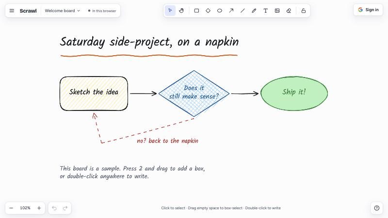
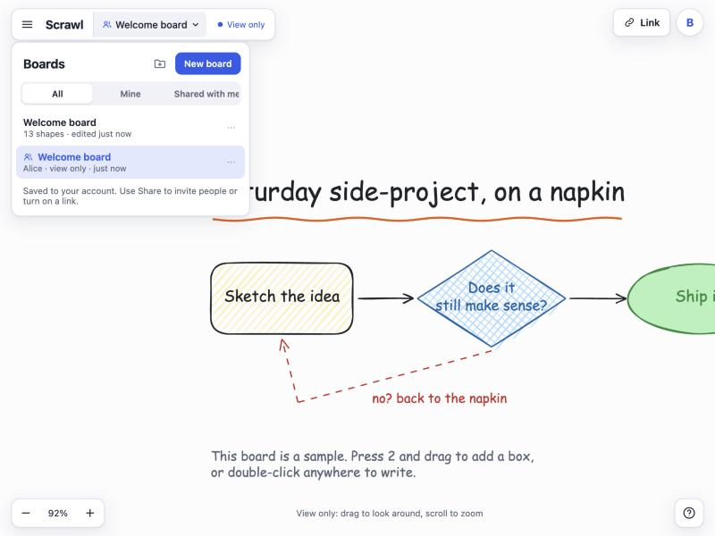
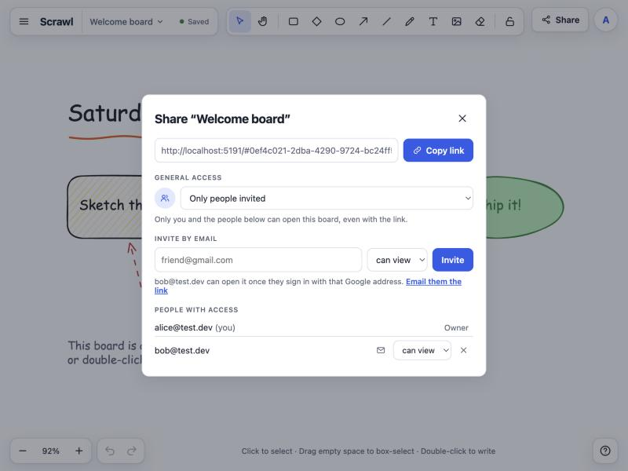

<div align="center">

# ✏️ Scrawl

**A hand-drawn whiteboard you can share.** Sketch boxes, arrows and notes that look like they were drawn on a napkin, keep as many boards as you like, and work on them with friends.

[](https://github.com/RedSnoww12/scrawl/releases)
[](https://github.com/RedSnoww12/scrawl/actions/workflows/ci.yml)
[](LICENSE)
[](https://scrawl-seven.vercel.app)
[](CONTRIBUTING.md)


[**Open the app →**](https://scrawl-seven.vercel.app) · [What's new](CHANGELOG.md) · [Report a bug](https://github.com/RedSnoww12/scrawl/issues/new/choose)

<br>

<picture>
  <source media="(prefers-color-scheme: dark)" srcset="docs/hero-dark.jpg">
  
</picture>

</div>

---

<p align="center">
  
  
</p>

## Features

- **Sketchy drawing**: rectangles, diamonds, ellipses, arrows, lines, freehand ink, text and images, all drawn with [rough.js](https://roughjs.com). Styles, layers, grouping, grid snapping, undo and redo, dark mode.
- **Connectors**: arrows and lines snap to shapes and stay attached when you move them.
- **Many boards**: create, rename and delete boards, and sort them into **folders**.
- **Google sign-in**: your boards follow you to every device.
- **Sharing**:
  - invite people by email, each as a **viewer** or an **editor**;
  - or turn on **"Anyone with the link"**, as view or edit;
  - only the owner can change access or delete the board.
- **Shared with me**: boards other people share with you show up in their own tab. You can file them in your own folders, or remove them from your list.
- **Live together**:
  - see everyone's cursor and name, and their strokes while they draw;
  - press `/` to leave a comment that follows your pointer;
  - click someone's avatar to see what they see, or double-click it to follow them as they move around;
  - if two people change the board at the same moment, Scrawl merges the two shape by shape instead of letting one overwrite the other.
- **Guest mode**: try it without an account. Boards stay in your browser, and you can copy them to your account when you sign in.
- **Files**: save and open `.scrawl.json`, export PNG or SVG, or copy the image to the clipboard.

## How it works

| Part | Where |
|---|---|
| Canvas engine: scene model, rendering, input, history. No React. | [`src/engine/`](src/engine) |
| Interface: toolbar, style panel, board list, share dialog | [`src/components/`](src/components) |
| Storage behind one interface: this browser (guest) or Supabase | [`src/lib/repos.ts`](src/lib/repos.ts) |
| Shape-by-shape merge when two people edit at once | [`src/lib/merge.ts`](src/lib/merge.ts) |
| Tables, access rules (row-level security) and functions | [`supabase/schema.sql`](supabase/schema.sql) |

All access control lives in the database:
- every board has an owner, plus optional invites (`board_members`) and an optional link setting;
- a `board_role()` function decides who is an owner, an editor, a viewer or nobody;
- every policy goes through that function;
- each save carries a version number, so a save made on an outdated copy is refused, merged and retried.

## Run it locally

You need Node 20 or newer.

```bash
git clone https://github.com/RedSnoww12/scrawl.git
cd scrawl
npm install
cp .env.example .env.local
npm run dev
```

Then open http://localhost:5173. Without your own Supabase project you can still use guest mode. `npm run build` type-checks and builds to `dist/`.

### Your own Supabase project

1. **Create the tables.** Run [`supabase/schema.sql`](supabase/schema.sql) in the SQL Editor. It is safe to run again after pulling changes.
2. **Turn on Google sign-in.**
   - In Google Cloud Console, create an OAuth client ID of type *Web application*.
   - Add `https://<project>.supabase.co/auth/v1/callback` as an authorized redirect URI.
   - In Supabase, open Authentication → Providers → Google, turn it on, and paste the client ID and secret.
3. **Set the redirect URLs.** In Authentication → URL Configuration, set the Site URL to your deployed address. Add that address and `http://localhost:5173` to the redirect URLs.
4. **Fill in `.env.local`** with your project URL and publishable key.

Both values ship to the browser and are public by design; the access rules protect the data. The Vercel ↔ Supabase integration's `NEXT_PUBLIC_SUPABASE_*` variables are picked up too.

Never put the database password or the `service_role` key in the app.

> While your Google OAuth app is in **Testing** mode, only the Google accounts listed as test users can sign in. Add your friends there, or publish the app.

### Deploy

Any static host works. On Vercel, import the repository: it detects Vite, runs `npm run build` and serves `dist/`.

## Keyboard

Press `?` in the app for the full list. The basics:
- `1`–`9` and `0` switch tools;
- `Ctrl Z` / `Ctrl ⇧ Z` undo and redo;
- `Ctrl D` duplicates, `Ctrl G` groups;
- `⇧ 1` zooms to fit, `G` toggles the grid.

## Contributing

Issues and pull requests are welcome: bug fixes, new tools, translations, accessibility. Read [CONTRIBUTING.md](CONTRIBUTING.md) to get set up and [CLAUDE.md](CLAUDE.md) for the project's rules, with the reasons behind them in [docs/adr](docs/adr/README.md). Open an issue first for big changes so we can agree on the approach.

To report a security problem, see [SECURITY.md](SECURITY.md) instead of opening a public issue.

## Releases

Scrawl follows [Semantic Versioning](https://semver.org/). Each version gets notes on the [releases page](https://github.com/RedSnoww12/scrawl/releases) and an entry in [CHANGELOG.md](CHANGELOG.md). In the app, the Keyboard shortcuts dialog (`?`) shows which version you're running.

## License

[MIT](LICENSE) © RedSnoww12
